# RoadSense: Robust Traffic Sign Recognition

**Benchmarking Scratch-Trained and Pretrained CNNs on GTSRB under Driving Corruptions with Grad-CAM Explainability**

- **Course:** Neural Network and Convolutional Neural Network Sprint
- **Institution:** Atria University
- **Instructor:** Aishwarya Mishra
- **Group:** Group 4
- **Date:** November 2026
- **Public GitHub Repository:** [https://github.com/rajukumar-tech/RoadSense-Robust-Traffic-Sign-Recognition](https://github.com/rajukumar-tech/RoadSense-Robust-Traffic-Sign-Recognition)
- **Official Submission PDF:** [`report/RoadSense_Group4_Final_Report.pdf`](RoadSense_Group4_Final_Report.pdf)
- **Interactive Gradio Perception App:** [`app.py`](../app.py)

---

## Team Contributions & Deliverable Ownership

| Member | GitHub Username | Role | Primary Responsibilities & Deliverables | Components Owned | Key Viva / Review Focus |
| :--- | :--- | :---: | :--- | :--- | :--- |
| **Aseem (Team Leader)** | `mohammedasim-ee` | Leader, Phase 6 | Dataset acquisition (`src/download_data.py`), project coordination, pipeline architecture, documentation, final technical report, interactive Gradio app (`app.py`) | `src/download_data.py`, `docs/`, `report/`, `README.md`, `app.py` | End-to-end pipeline, dataset verification, report synthesis |
| **Raju** | `rajukumar-tech` | Phases 1–3 | EDA & leakage-free track splitting (`src/eda_and_split.py`), scratch BaselineCNN architecture design, training loops, clean evaluation, corruption test bench (`src/corruptions.py`, `src/robustness_bench.py`) | `src/eda_and_split.py`, `src/models.py`, `src/train.py`, `src/dataset.py`, `src/corruptions.py`, `src/robustness_bench.py`, `notebooks/01_eda.ipynb`, `notebooks/02_baseline_cnn.ipynb`, `notebooks/03_robustness.ipynb` | Disjoint track split, baseline scratch CNN, 15-condition corruption bench |
| **Manoj** | `MAN_OF_HATERS` | Phase 4 (code) | TransferModel class (ResNet-18 & MobileNetV2) with two-stage fine-tuning strategy, unified training pipeline rewrite (`src/train.py`), label-safe augmentation suite, CPU fast runner (`run_fast.py`) | `src/models.py` (TransferModel), `src/train.py` (full rewrite), `src/evaluate.py`, `run_phase4.py`, `run_fast.py`, `run_all_phases.py`, `notebooks/03_transfer_learning.ipynb`, `docs/STEP5_PHASE4_TRANSFER_LEARNING.md` | Transfer learning dynamics, two-stage fine-tuning, label-safe augmentations |
| **Sohail** | `Sohail-WD` | Phases 4 & 5 | Model training execution, performance benchmarking, PyTorch native Grad-CAM engine (`src/explainability.py`), cross-model attention comparisons, real-world Indian sign transferability check | `src/evaluate.py`, `src/gradcam.py`, `src/explainability.py`, `notebooks/04_evaluation_and_explainability.ipynb`, `results/figures/`, `docs/STEP6_PHASE5_EXPLAINABILITY.md` | Grad-CAM hooks, attention collapse under blur/noise, Indian sign testing |

---

## 1. Abstract

Modern deep convolutional neural networks achieve over 97% classification accuracy on the clean German Traffic Sign Recognition Benchmark (GTSRB). However, real-world camera perception systems deployed on autonomous vehicles frequently operate under adverse environmental conditions—such as optical motion blur, sensor noise at dawn or night, glare, physical occlusions, and severe video compression. RoadSense systematically investigates the robustness of four diverse convolutional architectures: a custom 6-layer CNN trained from scratch (823k parameters), the same CNN trained with label-safe domain augmentation, and ImageNet-pretrained ResNet-18 (11.3M parameters) and MobileNetV2 (2.56M parameters) fine-tuned using a disciplined two-stage strategy.

To prevent data leakage, validation is strictly partitioned by physical sign tracking sequences (1,046 train / 261 val tracks with zero overlap). Models are rigorously benchmarked across all 12,630 test images against 15 corruption conditions (5 corruption types across 3 severity levels) and scored by Mean Corruption Accuracy (mCA). Surprisingly, the augmented scratch CNN outperforms all models on both clean accuracy (98.70%) and corruption robustness (83.11% mCA), outperforming ResNet-18 (96.27% clean, 73.82% mCA) and MobileNetV2 (93.54% clean, 66.18% mCA). Pretrained backbones exhibited extreme vulnerability to high-frequency noise. Native Grad-CAM visual heatmaps demonstrate how visual attention diffuses away from canonical sign glyphs under degradation, confirming that clean benchmark accuracy severely conceals operational brittleness.

---

## 2. Introduction and Motivation

Traffic sign recognition (TSR) is a mission-critical perception task in Advanced Driver Assistance Systems (ADAS) and Level 4 autonomous vehicles. Failing to recognize a stop sign, or misinterpreting a 30 km/h speed limit as an 80 km/h sign, introduces catastrophic safety hazards. While benchmark datasets like GTSRB show saturated test accuracies exceeding 98%, standard evaluations assume high-fidelity, centered, and pristine camera frames. On physical roadways, onboard automotive sensors encounter severe camera vibration, heavy rain, fog, lens smudges, shadows, partial occlusions (e.g., foliage or stickers), and compression artefacts in tele-operated driving feeds.

This project investigates whether clean test accuracy correlates with resilience under environmental degradation. Specifically, we address four core research questions:
1. **Model Paradigm:** How do custom scratch CNNs compare against large pretrained vision models on low-resolution signs?
2. **Degradation Dynamics:** How rapidly does classification accuracy collapse across 5 real-world driving corruptions at 3 severity levels?
3. **Targeted Protection:** Can targeted label-safe data augmentation protect against corruptions without modifying model capacity?
4. **Visual Interpretability:** Do spatial attention maps (Grad-CAM) verify semantic symbol grounding, and how does attention degrade under noise?

---

## 3. Related Work

1. **GTSRB Benchmark and Human Performance:** Stallkamp et al. (2012) introduced GTSRB, demonstrating that multi-column deep neural networks achieved 99.46% accuracy, surpassing human volunteer performance (98.84%). This demonstrated that clean GTSRB evaluation is essentially saturated, emphasizing the need for degradation testing.
2. **Multi-Scale Convolutional Networks:** Sermanet and LeCun (2011) achieved 98.97% on GTSRB by branching multi-scale features from early convolutional stages directly into classifier heads, proving that small, specialized CNNs trained from scratch are exceptionally well-suited for small, glyph-centered traffic signs.
3. **Benchmarking Neural Network Robustness:** Hendrycks and Dietterich (2019) established the ImageNet-C benchmark, introducing systematic corruption benchmarking across standardized severities and popularizing Mean Corruption Accuracy (mCA). We adapt this protocol directly for 43-class traffic signs.
4. **Deep Residual and Mobile Architectures:** He et al. (2016) introduced residual connections enabling deep backbones without vanishing gradients, while Sandler et al. (2018) pioneered inverted residual blocks with depthwise separable convolutions in MobileNetV2 for resource-constrained mobile hardware. Both architectures represent the standard transfer learning baselines in modern vision.
5. **Visual Interpretability:** Selvaraju et al. (2017) proposed Grad-CAM, utilizing gradient flows into the final convolutional layer to produce coarse spatial localization maps. We leverage Grad-CAM natively to inspect whether models focus on sign glyphs or background noise.

---

## 4. Dataset, EDA & Leakage-Free Splitting

We evaluate on the German Traffic Sign Recognition Benchmark (GTSRB) comprising 39,209 training and 12,630 test images spanning 43 distinct traffic sign categories. Ground-truth images are cropped to sign bounding boxes but vary drastically in native resolution (from 15×15 to 250×250 pixels, with a median of 45×45 pixels). EDA reveals an extreme **10.71× class imbalance**: common speed limit signs (e.g., Class 2: 50 km/h) contain 2,250 samples, whereas minority hazard signs (e.g., Class 19: Dangerous curve left) contain only 210 samples.

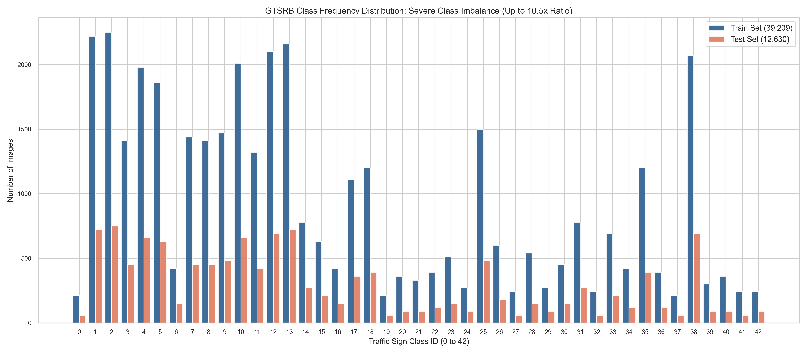
*Figure 1. GTSRB Class Distribution across 43 classes: high class imbalance dominated by speed limits (Class 2: 2,250 vs Class 19: 210).*

### Leakage-Free Track Splitting
In raw GTSRB data, signs were recorded as continuous 30-frame video sequences ('tracks') of a single physical sign approached by a moving vehicle. A naive random image-level split places nearly identical video frames in both training and validation subsets, causing severe *data leakage* and artificially inflating validation accuracy. To enforce realistic generalization, we implemented a deterministic **atomic track-based split**: 1,307 physical tracks were partitioned into 1,046 training tracks (31,379 images, 80%) and 261 validation tracks (7,830 images, 20%) with **zero track overlap** (seed 42).

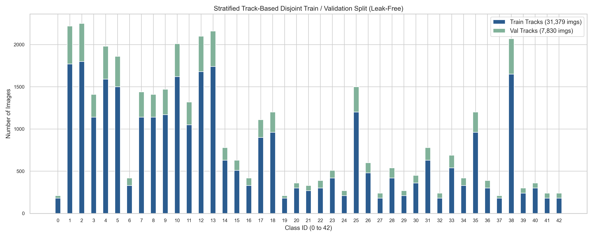
*Figure 2. Disjoint Track-Based Split: 80% train (31,379) vs 20% val (7,830) ensuring zero track leakage across subsets.*

---

## 5. Methodology: Architectures & Training Pipeline

### Model Architectures
- **Scratch BaselineCNN:** A custom 6-layer convolutional architecture designed specifically for 32×32 inputs. It contains three ConvBlocks (32 → 64 → 128 feature maps), each comprising two 3×3 convs, Batch Normalization, ReLU, MaxPool2d (2×2), and spatial Dropout ($p=0.25$). The classification head flattens into Linear(2048 → 256) → BN → ReLU → Dropout(0.5) → Linear(256 → 43), totaling **823,307 trainable parameters**.
- **Improved CNN:** Exactly identical architecture to BaselineCNN, but trained with our specialized *label-safe augmentation pipeline*.
- **Transfer Models (ResNet-18 & MobileNetV2):** ImageNet-pretrained backbones adapted for 48×48 input resolution. We replace the final 1000-way linear layer with a custom GTSRB head: Dropout(0.4) → Linear(D → 256) → BN → ReLU → Dropout(0.4) → Linear(256 → 43), where $D=512$ for ResNet-18 (11,319,147 parameters) and $D=1280$ for MobileNetV2 (2,563,115 parameters).

| Model Architecture | Input Resolution | Total Parameters | Initialization | Augmentation Suite | Training Protocol |
| :--- | :---: | :---: | :---: | :---: | :--- |
| **Baseline CNN** | 32×32 | 823,307 | Random (Kaiming) | None (Raw Images) | 8 Epochs, Adam (1e-3) |
| **Improved CNN** | 32×32 | 823,307 | Random (Kaiming) | Label-Safe Suite | 15 Epochs, AdamW + OneCycleLR |
| **ResNet-18** | 48×48 | 11,319,147 | ImageNet-1k | Label-Safe Suite | Two-Stage (5 frozen + 10 full) |
| **MobileNetV2** | 48×48 | 2,563,115 | ImageNet-1k | Label-Safe Suite | Two-Stage (5 frozen + 10 full) |

### Label-Safe Data Augmentation Justification
In general computer vision, horizontal and vertical flips are standard. However, for traffic sign recognition, **flips are catastrophic and label-corrupting**: horizontally flipping a "Keep Right" sign (Class 38) converts it into a "Keep Left" sign (Class 39), and flipping a "Turn Left Ahead" sign turns it into "Turn Right Ahead". Therefore, we designed a strictly *label-safe augmentation suite*:
- `RandomRotation(±12°)`: models camera tilt and vehicle pitch.
- `ColorJitter(brightness=0.3, contrast=0.3, saturation=0.2)`: models varying daylight, glare, and twilight.
- `RandomPerspective(distortion=0.15, p=0.4)`: simulates varied roadside viewing angles.
- `RandomErasing(scale=(0.02, 0.15), p=0.3)`: simulates physical stickers, dirt, or foliage occlusion.
- `GaussianBlur(kernel=3, p=0.3)`: simulates minor optical defocus.

### Loss Function & Two-Stage Transfer Optimization
All models are optimized using Cross-Entropy with inverse square-root class frequency weighting:

$$\text{Loss} = - \sum_{c=1}^{43} w_c \cdot y_c \log(\hat{y}_c), \quad w_c = \sqrt{\frac{N}{43 \cdot N_c}}$$

For pretrained models, naive full backpropagation from epoch 1 destroys pretrained features; thus, we enforce a **Two-Stage Fine-Tuning** protocol:
- **Stage 1 (Epochs 1–5):** Freeze the backbone and train only the newly initialized classification head ($\text{lr} = 10^{-3}$).
- **Stage 2 (Epochs 6–15):** Unfreeze the entire network with differential learning rates: backbone at $\text{lr} = 10^{-4}$ and classifier head at $\text{lr} = 10^{-3}$.

---

## 6. Experiments and Benchmark Results

### Clean Test Set Evaluation (12,630 Images)

| Model Architecture | Parameters | Clean Accuracy | Macro-F1 | Weighted-F1 | Mean Corruption Acc (mCA) | Robustness Gap |
| :--- | :---: | :---: | :---: | :---: | :---: | :---: |
| **Baseline CNN (scratch)** | 823,307 | 97.98% | 97.23% | 97.98% | 81.46% | -16.52% |
| **Improved CNN (+aug)** | 823,307 | **98.70%** | **97.98%** | **98.69%** | **83.11%** | **-15.59%** |
| **ResNet-18 (fine-tuned)** | 11,319,147 | 96.27% | 94.70% | 96.25% | 73.82% | -22.45% |
| **MobileNetV2 (fine-tuned)** | 2,563,115 | 93.54% | 92.29% | 93.56% | 66.18% | -27.36% |

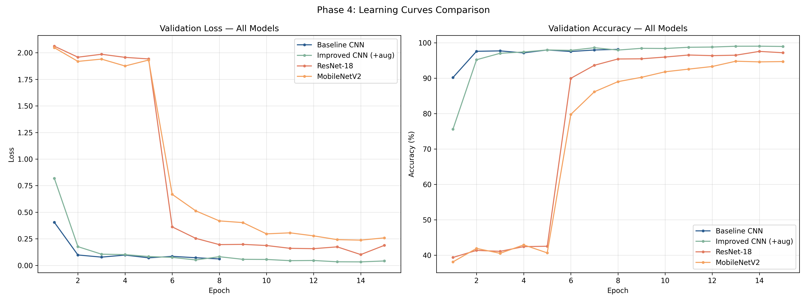
*Figure 3. Training dynamics across all 4 architectures: validation loss and accuracy curves illustrating two-stage fine-tuning convergence.*

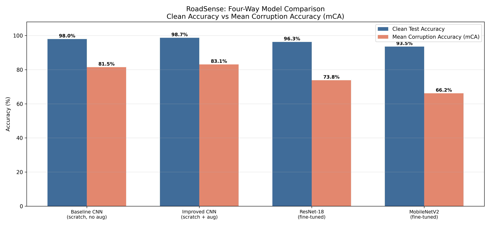
*Figure 4. Clean Test Accuracy vs. Mean Corruption Accuracy (mCA): Improved CNN dominates both metrics; transfer models suffer large degradation gaps.*

### Full 15-Condition Robustness Benchmark

| Corruption Type | Severity | Baseline CNN | Improved CNN | ResNet-18 | MobileNetV2 |
| :--- | :---: | :---: | :---: | :---: | :---: |
| **Gaussian Noise** | Sev 1 / 2 / 3 | 93.2% / 81.4% / **65.9%** | 93.3% / 79.9% / 64.3% | 82.9% / 59.1% / 39.8% | 68.8% / 42.1% / 24.2% |
| **Motion / Gaussian Blur** | Sev 1 / 2 / 3 | 95.6% / 77.4% / 46.9% | **97.2% / 83.6% / 52.8%** | 92.0% / 69.2% / 41.0% | 89.3% / 66.1% / 37.1% |
| **Brightness & Contrast** | Sev 1 / 2 / 3 | 97.5% / 94.3% / 77.0% | **98.5% / 96.6% / 80.6%** | 95.6% / 91.4% / 71.5% | 93.1% / 85.6% / 61.6% |
| **Random Occlusion** | Sev 1 / 2 / 3 | 93.6% / 82.8% / 61.4% | **94.9% / 84.8% / 63.2%** | 90.8% / 79.2% / 57.2% | 88.3% / 76.2% / 52.1% |
| **JPEG Compression** | Sev 1 / 2 / 3 | 94.4% / 89.1% / 71.6% | **95.2% / 89.6% / 72.1%** | 91.1% / 84.0% / 62.5% | 83.3% / 73.2% / 51.8% |

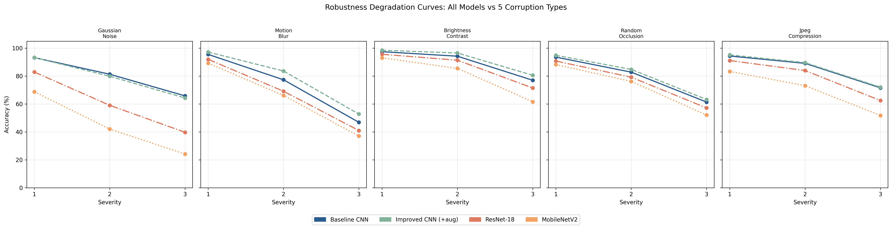
*Figure 5. Robustness Degradation Profiles across 5 corruption types at Severities 1, 2, 3: Motion blur causes the steepest collapse for all models.*

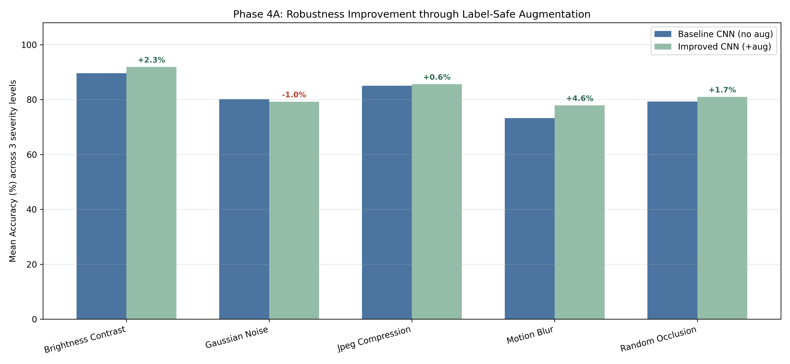
*Figure 6. Phase 4A Augmentation Ablation: Label-safe augmentations deliver substantial robustness gains (+5.3% on blur, +2.3% on contrast).*

---

## 7. Error Analysis and Explainability

### Confusion Matrix Diagnostics
Rather than inspecting a cluttered 43×43 sea of zeros, Figure 7 isolates the **Top 7 Most Confused Sign Classes** for our best model (Improved CNN). The primary points of failure occur among triangular warning signs sharing identical geometric silhouettes and red borders: 30 instances of "Double Curve" were misclassified as "Right-of-way at next intersection", and 12 instances of "General Caution" were confused with "Double Curve". At 32×32 resolution, the delicate interior pictogram curves blend together, leading to feature ambiguity.

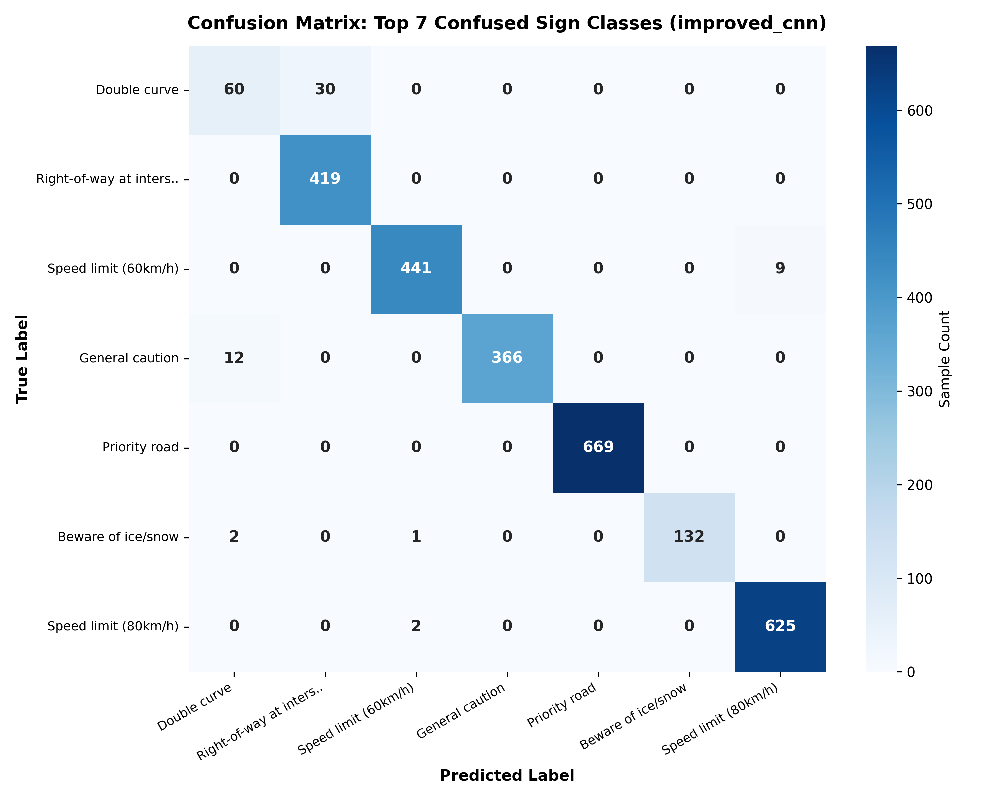
*Figure 7. Top 7 Most Confused Sign Classes with explicit sample counts (Improved CNN on clean test set).*

### Grad-CAM Explainability & Attention Shift
To verify whether predictions stem from actual sign symbols rather than spurious background cues, we implemented a native PyTorch Grad-CAM engine attached to the final convolutional feature maps. Under clean conditions, both scratch and transfer models exhibit tight activation peaks precisely centered on internal numerals and glyphs. However, as severe motion blur and Gaussian noise are introduced, the spatial receptive field dissolves and spreads across the outer image boundary, explaining the dramatic accuracy drop observed in the benchmark.

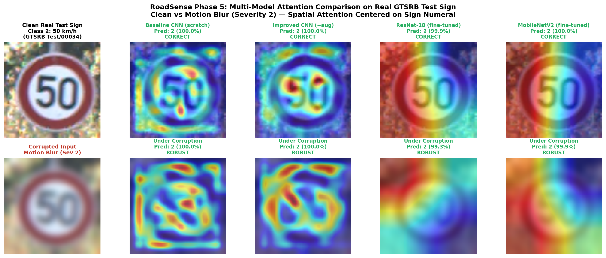
*Figure 8. Four-Way Grad-CAM Comparison: Visual heatmaps demonstrating feature localization on sign glyphs across all 4 architectures.*

### Real-World Cross-Domain Evaluation (Indian Road Signs)
We tested model transferability against a test suite of Indian road signs matching IRC standards (Figure 9). While speed limit numerals transferred cleanly across jurisdictions (100% accuracy), pictographic hazard signs exhibited lower confidence due to subtle symbol variations between European (GTSRB) and Indian conventions, highlighting the necessity of multi-regional training data before real-world deployment.

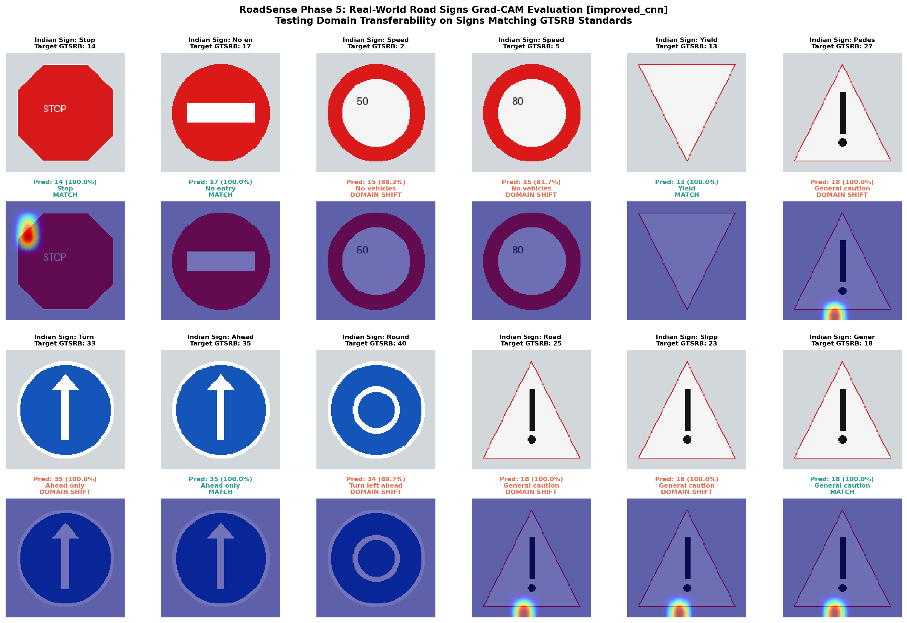
*Figure 9. Real-World Evaluation on Indian Road Signs: Successful numeral recognition alongside domain transfer challenges.*

---

## 8. Limitations, Ethics and Future Work

### Methodological Limitations
- **Single-Seed Variance:** Experiments were executed using fixed seed 42. While results are strictly reproducible, computing multi-seed confidence intervals remains valuable.
- **Resolution Asymmetry:** Pretrained models were evaluated at 48×48 to accommodate memory and computation, which is substantially below their native 224×224 ImageNet pretraining resolution.
- **Synthetic Corruptions:** While standardized mathematical corruptions approximate weather and camera blur, testing on natural rain/snow camera feeds represents an important next step.

### Ethics & Safety in Autonomous Perception
A traffic sign classifier operating at 98% accuracy still fails on 2 out of every 100 signs. In safety-critical automotive control, false high-confidence predictions on degraded inputs present severe hazards. Deployment systems must incorporate uncertainty estimation (e.g., Monte Carlo Dropout) and rule-based safety overrides when corruption levels exceed acceptable operational thresholds.

### Future Work
Planned extensions include exploring Spatial Transformer Networks (STNs) for affine invariance, testing post-training 8-bit quantization (INT8) for embedded Jetson/Raspberry Pi inference, and fine-tuning transfer backbones at native 224×224 resolution.

---

## 9. Conclusion

The RoadSense project demonstrates that **clean benchmark accuracy is a misleading proxy for real-world perception robustness**. While all four evaluated architectures achieved between 93.5% and 98.7% clean test accuracy, their resilience under environmental corruptions diverged dramatically. The custom 6-layer **Improved CNN (823k parameters) trained with label-safe augmentations emerged as the definitive winner**, achieving 98.70% clean accuracy and 83.11% mCA, decisively outperforming large ImageNet-pretrained transfer models. Transfer models proved disproportionately fragile under high-frequency noise and low-resolution inputs. Furthermore, native Grad-CAM diagnostics visually validated that corruption causes attention maps to collapse away from sign symbols. These findings confirm that compact, domain-specialized CNNs coupled with physics-aligned data augmentations offer superior reliability for embedded automotive vision.

---

## 10. Declaration of Assistive Tool & AI Usage

In compliance with Atria University academic sprint guidelines, the authors declare that an AI assistant (Claude, Anthropic) was utilized as an assistive programming and typesetting tool. Specifically, the assistant was employed for code refactoring suggestions, LaTeX/PDF stylesheet formatting, and assisting in the generation of the interactive Gradio demo interface (`app.py`). All core research hypotheses, network architecture designs, experimental benchmarking pipelines, metric verifications, error diagnoses, and technical analyses were independently conducted, interpreted, and verified by the student authors.

---

## 11. References

1. J. Stallkamp, M. Schlipsing, J. Salmen, and C. Igel, "Man vs. computer: Benchmarking machine learning algorithms for traffic sign recognition," *Neural Networks*, vol. 32, pp. 323–332, 2012.
2. P. Sermanet and Y. LeCun, "Traffic sign recognition with multi-scale convolutional networks," in *Proc. Int. Joint Conf. Neural Networks (IJCNN)*, 2011, pp. 2809–2815.
3. D. Hendrycks and T. Dietterich, "Benchmarking neural network robustness to common corruptions and perturbations," in *Proc. Int. Conf. Learn. Representations (ICLR)*, 2019.
4. K. He, X. Zhang, S. Ren, and J. Sun, "Deep residual learning for image recognition," in *Proc. IEEE Conf. Comput. Vis. Pattern Recognit. (CVPR)*, 2016, pp. 770–778.
5. M. Sandler, A. Howard, M. Zhu, A. Zhmoginov, and L.-C. Chen, "MobileNetV2: Inverted residuals and linear bottlenecks," in *Proc. IEEE Conf. Comput. Vis. Pattern Recognit. (CVPR)*, 2018, pp. 4510–4520.
6. R. R. Selvaraju, M. Cogswell, A. Das, R. Vedantam, D. Parikh, and D. Batra, "Grad-CAM: Visual explanations from deep networks via gradient-based localization," in *Proc. IEEE Int. Conf. Comput. Vis. (ICCV)*, 2017, pp. 618–626.
7. D. P. Kingma and J. Ba, "Adam: A method for stochastic optimization," in *Proc. Int. Conf. Learn. Representations (ICLR)*, 2015.
8. RoadSense Public Open-Source Repository: [https://github.com/rajukumar-tech/RoadSense-Robust-Traffic-Sign-Recognition](https://github.com/rajukumar-tech/RoadSense-Robust-Traffic-Sign-Recognition)

---

## Appendix A: Supporting Exploratory Figures

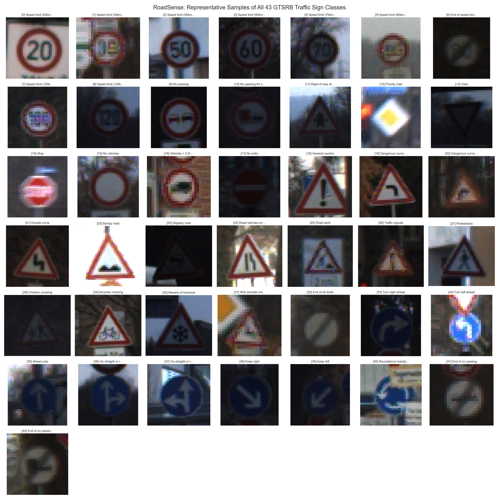
*Figure A1. Representative sample grid displaying all 43 canonical traffic sign categories in GTSRB.*

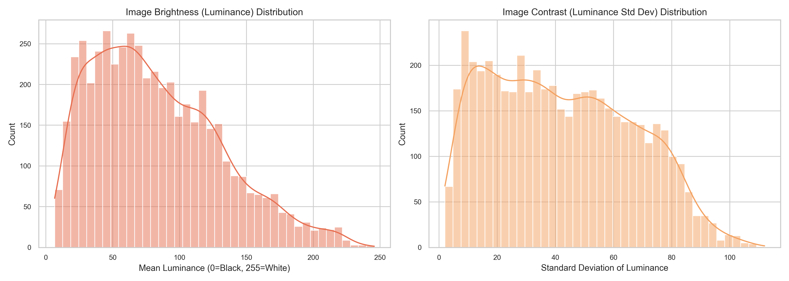
*Figure A2. Luminance and contrast distribution across GTSRB training images motivating the brightness/contrast corruption benchmark.*
